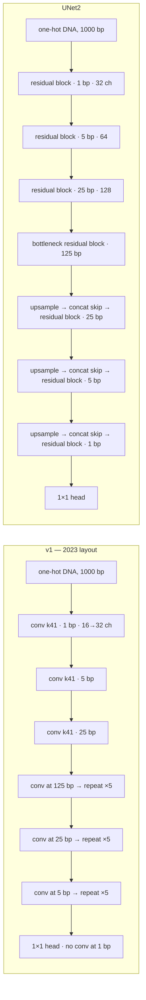

# DNA coding-sequence segmentation with a 1D U-Net

A small convolutional network that finds protein-coding sequences (CDS) in raw human DNA, base by base. It reads one-hot encoded DNA and returns, for every base, the probability that it lies in a CDS.

The project has two versions:

- **2026 (current):** the method rebuilt as a reproducible pipeline (`cdsseg/`), evaluated on whole held-out chromosomes with a metric that works under heavy class imbalance, and a redesigned network (UNet2). Test MCC went from **0.18** (2023 protocol) to **0.70–0.74**.
- **2023 (original):** individual research project, Bauman Moscow State Technical University; notebooks and the paper draft are kept in [`notebooks/`](notebooks/) and [`paper/`](paper/draft_2023_cleaned.docx) and summarised [at the end](#the-2023-version).

Full results with all tables: [`docs/RESULTS.md`](docs/RESULTS.md). Open questions and their status: [`docs/RESEARCH_STATUS.md`](docs/RESEARCH_STATUS.md).

## Main result

Test set: **whole chromosomes 20 and 21** (104 Mbp, 1.1 % of bases are CDS), never seen in training or model selection. Mean ± sd over 3 seeds unless marked.

| Model | Parameters | Test MCC | Segment F1 (both ends ±10 bp) | Training time, M2 Max |
|---|---|---|---|---|
| 2023 model, 2023 protocol | 0.49 M | 0.18 ± 0.12 | 0.00 | — |
| 2023 model, honest protocol | 0.49 M | 0.425 ± 0.005 | 0.02 | 3 min |
| 2023 layout, best settings + 1-bp convolution | 2.0 M | 0.594 ± 0.009 | 0.15 | 14 min |
| **UNet2** (residual blocks) | 5.6 M | **0.704 ± 0.001** | **0.30** | 32 min |
| UNet2, kernel 11 (1 seed) | 1.5 M | 0.670 | 0.33 | 12 min |
| UNet2, 32k training steps (1 seed) | 5.6 M | 0.740 | 0.37 | 62 min |

<p align="center">
  
</p>

For scale: SegmentNT, a DNA foundation model for the same kind of base-level genome annotation, has 563 M parameters and was trained for 20 h on 8 H100 GPUs. A head-to-head comparison on the same task (our CDS labels, same test chromosomes) is planned and not yet run; published SegmentNT numbers are averages over 14 other element types and are **not** comparable with the table above.

## What was wrong with the 2023 evaluation

| 2023 | 2026 | Why |
|---|---|---|
| Chromosome 1 only, random 80/10/10 split of windows | Train chr1–19, validate chr22, test chr20 + 21 (the SegmentNT split) | A random split puts overlapping windows of the same genes in train and test |
| CDS between 9 and 300 bp kept | All CDS | Segments over 300 bp are 7 % of CDS segments but 32 % of coding bases |
| Test on sampled windows at a fixed class ratio | Whole-chromosome scan, natural ratio (1 : 89 by base) | The real use case |
| Per-window Dice | Base-level MCC, plus AUPRC and segment-level F1 | Dice fails on empty windows (below) |
| Dice loss | Binary cross-entropy, model selection by validation MCC | Dice-type losses collapsed to a constant output |

**Why Dice fails.** On a window without CDS, a correct empty prediction scores 0, so with CDS-free windows dominating, an *empty predictor* gets a mean per-window Dice of **0.94** and beats every trained model. All Dice variants from the 2023 draft (smoothing *k*, truncated, weighted, symmetric) still rank the empty predictor first ([`docs/metric_study.png`](docs/metric_study.png)). MCC gives trivial predictors 0 and ranks models correctly; it is also the metric used by SegmentNT and the BEND benchmark.

## Architecture: 2023 layout (v1) vs UNet2



Each change was tested on its own, on top of the previous best, with 3 seeds:

| Decision | Reason | Evidence (test MCC) |
|---|---|---|
| Wider channels (16 → 32 → 64 base width) | The 2023 model was capacity-limited: no overfitting, flat learning curve over the amount of data | 0.425 → 0.479 (32) → 0.482 (64) at batch 128 |
| BatchNorm + batch 32 | Batch 512 → 0.357, 32 → 0.440; BatchNorm alone +0.047; together they stabilise training of wider models | 0.479 → 0.568 |
| Convolution at 1-bp resolution | In the 2023 decoder the last convolution runs at 5-bp steps; only a 1×1 head sees single bases, so boundaries are blurred | 0.568 → 0.594; segment F1 0.099 → 0.145 |
| Standard decoder order (upsample → concat → convolve) | The 2023 decoder convolves *before* upsampling, so the convolution never sees the skip-connection detail | 0.596 (UNet2, plain blocks) |
| **Residual blocks** (two convolutions + BatchNorm + shortcut) | Each block learns a correction to its input; the shortcut keeps gradients flowing. Plain stacks of 3 convolutions were unstable (0.24 ± 0.22) | **0.596 → 0.704**, the largest single gain; better than the 2023 layout at 7.7 M parameters (0.625) |
| Reverse-complement averaging + 250-bp edge cropping at inference | A gene can be on either strand; bases near window edges see little context (accuracy reaches its plateau ~100–250 bp from an edge) | +0.026 MCC, +0.07 segment F1, same weights, no retraining |
| Single merged label (not one output per strand) | Tested per-strand outputs | 0.704 vs 0.704 — no gain, so the simpler model is kept |
| Kernel 41, window 1 kb, 3 pooling levels of ×5 | Inherited from 2023; levels see ~codons/splice sites (1 bp), exon scale (5–25 bp), gene context (125 bp) | Depth 2/3/4 ≈ equal; window 2–4 kb no better; kernel ≥ 31 needed in v1. Kernel per level is being re-examined: the bottleneck is only 8 positions long, so most of a 41-wide kernel sees padding |

<p align="center">
  
  <br><sub>UNet2 (squares) beats the 2023 layout (circles) at every size: 1.5 M UNet2 (0.670) &gt; 7.7 M 2023 layout (0.625).</sub>
</p>

<p align="center">
  
  <br><sub>Validation MCC during training. No overfitting; UNet2 was still improving at 16k steps, and 32k steps added +0.035.</sub>
</p>

## Other experiments

**What limits the model** (UNet2, 1 seed each, vs 0.705 for the same seed at default settings):

| Change | Test MCC | Note |
|---|---|---|
| Train on 1 / 4 / 19 chromosomes | 0.680 / 0.686 / 0.705 | More data helps mildly |
| Learning rate 1e-3 / 2e-3 / 4e-3 | 0.681 / 0.705 / 0.714 | 2e-3–4e-3 |
| 16k → 32k training steps | 0.705 → 0.740 | The biggest remaining lever |
| Width 32 → 16 → 8 | 0.704 → 0.62 → 0.50 | Width 32 is needed |
| Kernel 41 → 21 → 11 | 0.704 → 0.692 → 0.670 | Half and a quarter of the parameters for −0.01 / −0.03 |

**Two-stage idea: classify the window first, segment only positive windows.** Implemented as one network with two heads: a window head on the bottleneck ("is there any CDS here?") and the segmentation decoder, which runs only on windows the gate passes (threshold set on validation to keep 99 % of CDS windows). Compared with its one-head twin of the same size trained separately:

| | Two-head (3 seeds) | One-head twin |
|---|---|---|
| Parameters | 5,567,842 | 5,567,585 |
| Segmentation quality (gate off) | MCC 0.627 ± 0.006 | 0.704 ± 0.001 |
| Effect of the gate at inference | 0.627 → 0.627 (no loss) | — |
| Windows decoded | 64 % | 100 % |
| Test scan time | 575 s vs 766 s (−25 %) | 766 s |

The gate itself costs no accuracy and saves a quarter of the compute; training both heads jointly with equal loss weights hurt the shared encoder. With the gate loss weighted 0.1 the two-head model matches its twin (MCC 0.706, segment F1 0.310, 1 seed) while decoding only 60 % of windows (−29 % inference time). Scoring the same predictions on test sets from balanced to natural composition shows that the gate does not remove false positives (the windows it drops were already predicted empty) and that balanced test sets can reverse the ranking of models ([`docs/RESULTS.md`](docs/RESULTS.md#35-test-set-composition)).

**Isolated fragments** (no flanking sequence; relevant to draft assemblies and metagenomic contigs; measured on the 2023-layout model, to be repeated for UNet2): fragments of 500–1000 bp lose little (MCC 0.53–0.56 vs 0.58 on whole chromosomes), 100–150 bp drop to 0.35–0.40; a model is best applied at the window length it was trained on ([`docs/fragment_length.png`](docs/fragment_length.png)).

**Main weakness.** Base-level accuracy is good, but exact CDS boundaries are recovered for about a third of segments, and short exons (< 70 bp) are often missed. Next steps: a structural decoding layer (HMM/CRF) on top of the network, comparison with SegmentNT, Tiberius and AUGUSTUS on the same labels and test chromosomes, and a final evaluation of a frozen configuration.

## Reproduce

```bash
conda create -n cdsseg python=3.11 && conda activate cdsseg
pip install -r requirements.txt
# download GRCh38.p14 RefSeq GFF (NCBI) and hg38 chr1-22 FASTA (UCSC) into data/raw/, then
python -m cdsseg.data.prepare
python -m cdsseg.train --name unet2 --model unet2 --model-kwargs '{"channels":[32,64,128],"residual":true,"strands":1}' \
    --batch-size 32 --steps 16000 --eval-every 1000 --select mcc --rc-average true --crop 250
python experiments/sweep.py --groups v2 --dry-run    # every experiment above is a sweep group
python experiments/report_figures.py                  # summary tables in results/, figures in figures/
```

Training and evaluation run on Apple Silicon (PyTorch MPS) or CUDA/CPU. Per-run outputs go to `runs/` (not tracked); the summary of all runs is in [`results/experiments.csv`](results/experiments.csv).

## The 2023 version

The original work used chromosome 1 only, CDS of 9–300 bp, 1 : 1 positive/negative windows and Dice loss, and compared a one-stage U-Net with a two-stage classifier + U-Net design. It identified the failure of Dice on empty windows and proposed modified Dice variants; the 2026 analysis confirms the problem but shows the variants do not fix it (above). The best 2023 model reached a per-window Dice of 0.65 on balanced windows; under the honest protocol the same model scores MCC 0.18 ± 0.12.

<p align="center">
  
  <br><sub>2023: true CDS in red, predicted probability in green.</sub>
</p>

## Repository structure

```
├── cdsseg/                      pipeline: data preparation, models, losses, metrics, training, inference
│   ├── data/prepare.py          GFF + FASTA → per-chromosome base and CDS-mask arrays
│   ├── models.py                2023 layout (UNet1D), UNet2, baselines (dilated ResNet, CNN-BiLSTM)
│   ├── train.py                 chromosome hold-out training, whole-chromosome test
│   └── predict.py, metrics.py, losses.py
├── experiments/                 sweeps, metric study, fragment-length study, report figures
├── tests/                       unit tests
├── docs/                        experiment plan, research status, figures
├── results/                     summary tables of all runs
├── notebooks/, models/          2023 notebooks and Keras models
├── figures/
└── paper/draft_2023_cleaned.docx
```

## Stack

Python, PyTorch (MPS), NumPy, pandas, Matplotlib; 2023 version: TensorFlow / Keras, MONAI, Biopython, scikit-learn.

## Related

The project grew out of the team course project [gene_predict_project](https://github.com/polilya/gene_predict_project), which predicts UTR boundaries with classical ML. This repository is individual work.

## Author

Ilia Poludkin · [Google Scholar](https://scholar.google.com/citations?user=x5zcWz0AAAAJ) · [ORCID](https://orcid.org/0000-0003-3198-3612) · [LinkedIn](https://linkedin.com/in/polilya)
