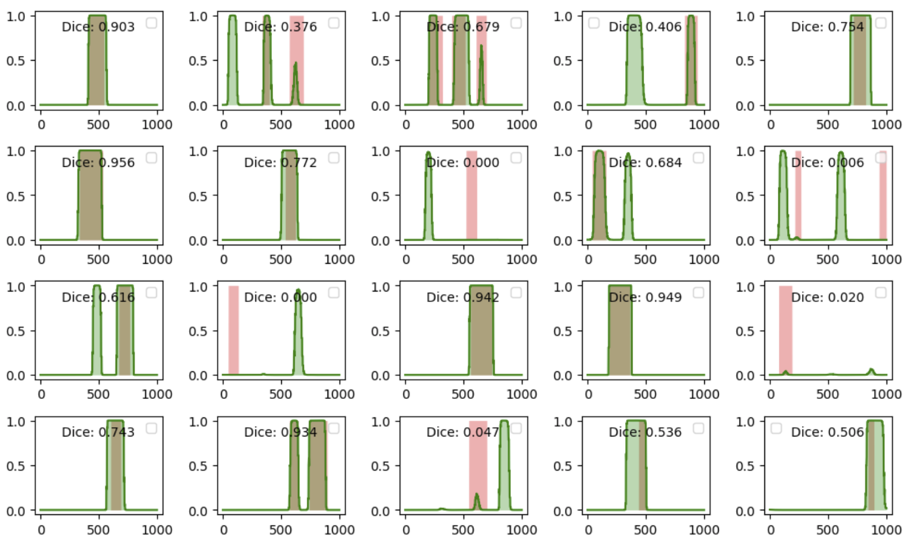
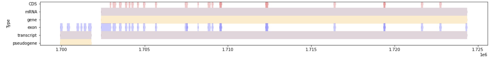
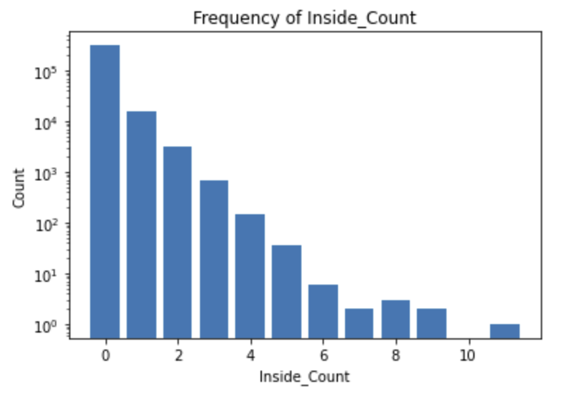
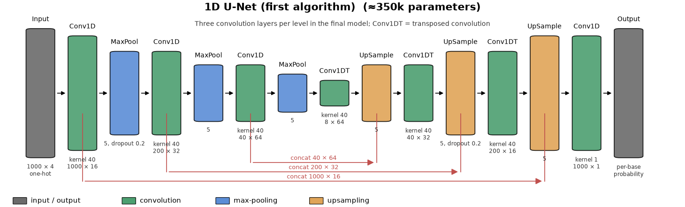
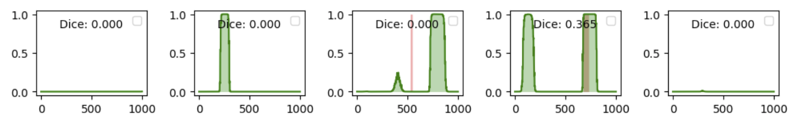
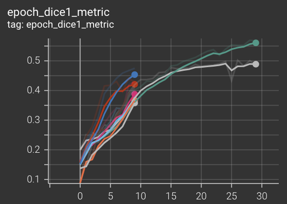

# DNA coding-sequence segmentation with a 1D U-Net

Deep-learning pipeline that finds protein-coding sequences (CDS) in raw human DNA. A 1D convolutional U-Net reads a 1,000-base window of one-hot encoded DNA and returns, for every base, the probability that it belongs to a CDS. The project also shows why the standard Dice metric fails on this task and tests modified Dice variants that fix it.

Individual research project, Bauman Moscow State Technical University, 2023; notebooks revised in 2025. The paper draft is in [`paper/`](paper/draft_2023_cleaned.docx).

<p align="center">
  
  <br><sub>Random test windows: true CDS location in red, predicted probability in green, Dice score per window.</sub>
</p>

## Data

Human reference genome GRCh38, chromosome 1 (NC_000001.11), with the NCBI RefSeq annotation. To keep the full pipeline runnable on one laptop, only chromosome 1 and annotations from the single source `BestRefSeq` are used.

| Step | Result |
|---|---|
| Chromosome 1 sequence | 248,956,422 bases |
| GFF annotation, filtered to `BestRefSeq` on chromosome 1 | 169,256 features |
| Duplicates removed | 56,676 features |
| Type `CDS` | 22,309 regions |
| CDS length between 9 and 300 bases (92.2 % of all CDS) | 20,562 positive windows |

Each positive sample is a 1,000-base window with a CDS at a random position, plus a per-base mask of where the CDS is. Negative samples are random CDS-free windows with an empty mask. For testing on realistic data, the chromosome is cut with a sliding 1,000-base window and a 700-base step, giving about 356,000 windows. In this setting CDS-free windows outnumber CDS windows by roughly 60 to 1, so the experiments use class ratios of 1:1, 1:10 and 1:60.

<p align="center">
  
  <br><sub>Annotation tracks (gene, mRNA, exon, CDS) in a region of chromosome 1.</sub>
</p>

<p align="center">
  
  <br><sub>Number of CDS per 1,000-base window across chromosome 1 (log scale).</sub>
</p>

`data/cds.csv` holds the extracted CDS coordinates. The genome and annotation are not included because of their size; download them from NCBI (chromosome 1 FASTA and the RefSeq GFF for GRCh38) and run `notebooks/01_data_preparation.ipynb` to rebuild the training sets.

## Models

Two designs are compared:

1. **One-stage:** a 1D U-Net segments every window directly.
2. **Two-stage:** a 1D CNN classifier first decides whether a window contains a CDS, and the U-Net then segments only the windows it flags.

<p align="center">
  
  <br><sub>Final 1D U-Net: three encoder and decoder levels with skip connections, about 350k parameters.</sub>
</p>

Hyperparameters were chosen by one-factor sweeps (15 epochs each) over activation function, channel count, kernel size, convolutions per level, pooling size and dropout. The final model uses ReLU, 16–32–64 channels, kernel size 40, three convolutions per level, max-pooling 5–5–5 and dropout 0.2.

## Why standard Dice fails here

Dice measures the overlap of the true and predicted masks. On a window that contains no CDS, a correct prediction of "nothing" still scores 0, the same as a wrong prediction, because the overlap term is zero. With CDS-free windows dominating real data, standard Dice cannot tell a good model from a bad one.

<p align="center">
  
  <br><sub>Standard Dice gives 0 both to a correct empty prediction (left) and to wrong predictions.</sub>
</p>

Variants tested:

| Variant | Idea | Outcome |
|---|---|---|
| Truncated Dice | Scores an empty window 1 if all predicted probabilities stay below 0.2 | Correct at evaluation, but not differentiable, so unusable as a training loss |
| Weighted Dice | Separate weights for false positives and false negatives, set from the CDS to non-CDS length ratio (about 1:5) | Helps when training on positive windows only; empty windows still divide by zero |
| Symmetric Dice | Dice of the mask plus weighted Dice of the inverted mask | Treats false positives and false negatives alike |
| Dice with a large smoothing term *k* | *k* = 0.3 or 3 instead of the usual 10⁻³ | Gives empty windows a non-zero score; *k* = 3 gave the most usable training behaviour |

## Results

| Model | Training data | Loss | Test Dice by class ratio |
|---|---|---|---|
| `model_1t` | 15k windows, 1:1, 10 epochs | standard Dice | 0.53 (1:1) |
| `model_4t` | 3k positive windows, 10 epochs | standard Dice | 0.61 (positives only), 0.42 (1:1), 0.12 (1:10), 0.02 (1:60) |
| symmetric | 3k windows, 1:1, 10 epochs | symmetric Dice | 0.65 (1:1) |
| `model_6t` | 6k windows, 1:1, 10 epochs | Dice, *k* = 0.3 | 0.43 (1:1), 0.22 (1:10) |
| `model_7t` | 6k windows, 1:1, 30 epochs | Dice, *k* = 3 | 0.49 (1:1) |

The best model reaches a Dice of 0.65 on balanced test data. It localises coding regions well, but marks their exact boundaries less precisely. The steep drop at realistic class ratios is the main open problem. The two-stage design, where a classifier first filters out empty windows, is meant to address it; its full comparison with the one-stage model is the next step.

<p align="center">
  
  <br><sub>Dice over training epochs (TensorBoard) for the compared configurations.</sub>
</p>

## Repository structure

```
├── notebooks/
│   ├── 01_data_preparation.ipynb   parse the genome and annotation, build windows and masks
│   └── 02_unet_segmentation.ipynb  train and evaluate the 1D U-Net and Dice variants
├── models/                         trained Keras models from the results table (.h5)
├── data/cds.csv                    CDS coordinates extracted from the annotation
├── figures/
└── paper/draft_2023_cleaned.docx   paper draft (2023, English)
```

The segmentation notebook was run in Google Colab; when running it locally, skip the Google Drive cell and put the generated `data_masks_long.csv` in `data/`.

## Stack

Python, TensorFlow / Keras, PyTorch, MONAI, Biopython, pandas, NumPy, scikit-learn, Matplotlib, TensorBoard.

## Related

The project grew out of the team course project [gene_predict_project](https://github.com/polilya/gene_predict_project), which predicts UTR boundaries with classical ML. This repository is individual work.

## Author

Ilia Poludkin · [Google Scholar](https://scholar.google.com/citations?user=x5zcWz0AAAAJ) · [ORCID](https://orcid.org/0000-0003-3198-3612) · [LinkedIn](https://linkedin.com/in/polilya)
