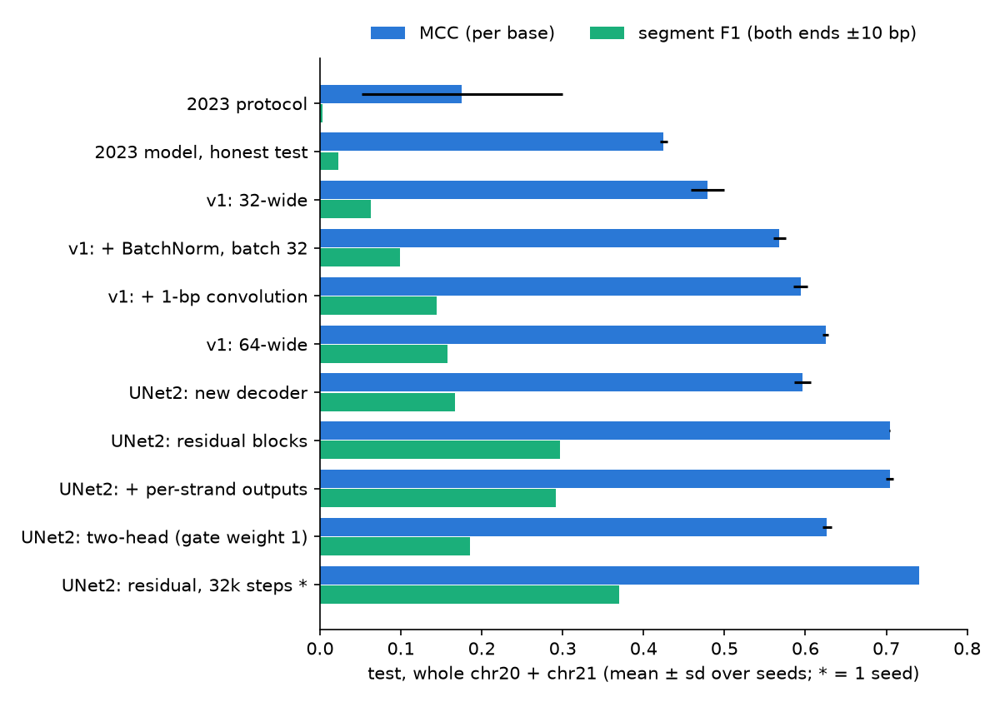
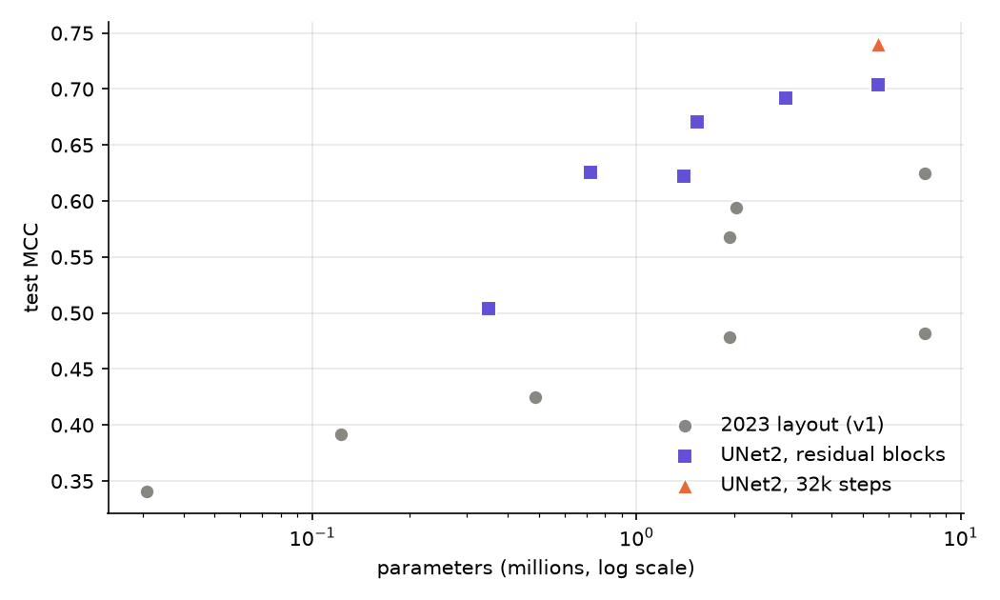
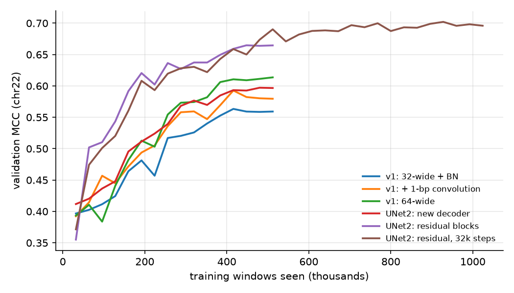
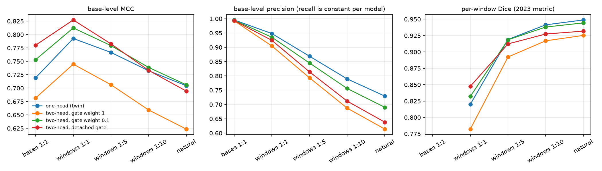
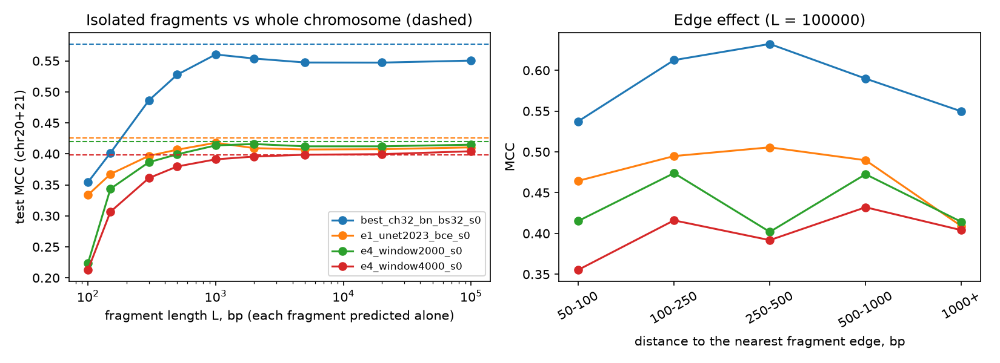

# Results — CDS segmentation, version 2 (November 2026)

All numbers are on the **test set: whole chromosomes 20 and 21** (104 Mbp of non-N sequence, 1.12 % of bases are CDS, 1 : 89), never used for training, threshold choice or model selection. Training: chromosomes 1–19; validation (model selection, thresholds): chromosome 22. Labels: RefSeq `BestRefSeq` CDS on either strand. Mean ± sd over seeds; runs with one seed are marked *(1 seed)* and are indicative only. All tables are generated from `runs/` by `experiments/report_figures.py` into [`results/experiments.csv`](../results/experiments.csv).

**Status of these numbers.** They come from the model-*selection* phase: about 60 configurations were compared on the same test set. Validation and test MCC agree closely across configurations (Pearson r = 0.994 over 59 configurations), so choosing by validation would have picked the same models, but the best test score is still mildly optimistic. A final evaluation of one frozen configuration (3–5 seeds, test used once, homologous-gene filtering, external comparisons) is planned and not yet done.

## 1. Metrics

| Metric | Why |
|---|---|
| Base-level MCC (main) | Uses all four cells of the confusion matrix; trivial predictors score 0; robust to the 1 : 89 imbalance; used by SegmentNT and BEND |
| AUPRC, F1, precision, recall | Threshold-free ranking quality; error type |
| Segment F1 (both ends within ±0 / 3 / 10 bp) | Gene-finding convention: is the whole CDS segment recovered? |
| Per-window Dice | Only to compare with the 2023 draft; **invalid** here: an empty predictor scores 0.94 and beats every trained model, and every Dice variant from the draft still ranks it first (`docs/metric_study.png`) |

## 2. From the 2023 protocol to UNet2

| Stage | Parameters | Test MCC | AUPRC | Segment F1 ±10 bp | Seeds |
|---|---|---|---|---|---|
| 2023 model trained with the 2023 protocol (chr1, CDS 9–300 bp, 1 : 1 windows, Dice loss) | 0.49 M | 0.26 (seeds 0.274, 0.253; the third collapsed to MCC 0) | 0.11 | 0.00 | 3 |
| 2023 model, honest protocol (19 chromosomes, BCE) | 0.49 M | 0.425 ± 0.005 | 0.397 | 0.023 | 3 |
| v1 (2023 layout) 32-wide | 1.94 M | 0.479 ± 0.020 | 0.475 | 0.063 | 3 |
| v1 32-wide + BatchNorm + batch 32 | 1.94 M | 0.568 ± 0.008 | 0.576 | 0.099 | 3 |
| v1 + convolution at 1-bp resolution | 2.02 M | 0.594 ± 0.009 | 0.621 | 0.145 | 3 |
| v1 64-wide + BatchNorm + batch 32 | 7.74 M | 0.625 ± 0.003 | 0.652 | 0.158 | 3 |
| UNet2, standard decoder, plain blocks | 3.07 M | 0.596 ± 0.010 | 0.619 | 0.167 | 3 |
| **UNet2, residual blocks** | 5.57 M | **0.704 ± 0.001** | **0.757** | **0.296** | 3 |
| UNet2 + per-strand outputs | 5.57 M | 0.704 ± 0.005 | 0.757 | 0.292 | 3 |
| UNet2, residual, 32k training steps | 5.57 M | 0.740 | 0.805 | 0.370 | 1 |

UNet2 rows use reverse-complement averaging and 250-bp edge cropping at inference; without them the same checkpoints score 0.583 (plain blocks), 0.678 ± 0.004 (residual) and 0.673 (per-strand).

## 3. What each experiment showed

### 3.1 2023 layout (v1): 135-run sweep, one factor at a time, 3 seeds

| Factor | Result | Conclusion |
|---|---|---|
| Training chromosomes 1 / 2 / 4 / 8 / 19 | 0.415 / 0.419 / 0.396 / 0.400 / 0.425 | Not data-limited at this size |
| Width 4 / 8 / 16 / 32 / 64 (base channels) | 0.341 / 0.392 / 0.425 / 0.479 / 0.482 | Capacity-limited |
| Kernel 5 / 9 / 15 / 21 / 31 / 41 / 61 | 0.305 / 0.346 / 0.383 / 0.405 / 0.420 / 0.425 / 0.428 | Context ≥ 31 bp needed |
| Depth 2 / 3 / 4 levels | 0.430 / 0.425 / 0.435 | No effect |
| Convolutions per level 1 / 2 / 3 | 0.425 / 0.424 / 0.244 ± 0.220 | 3 plain convolutions unstable |
| BatchNorm | 0.472 (+0.047) | Helps |
| Batch 32 / 64 / 128 / 256 / 512 (same windows seen) | 0.440 / 0.419 / 0.425 / 0.400 / 0.357 | Small batches better |
| Learning rate 3e-4 / 1e-3 / 2e-3 / 5e-3 | 0.375 / 0.407 / 0.425 / 0.384 | 2e-3 |
| Window 1 / 2 / 4 kb | 0.425 / 0.417 / 0.418 | No gain from longer windows |
| CDS enrichment of training windows 0.5 / 0.2 / none | 0.425 / 0.419 / 0.396 | Enrichment helps a little |
| Loss: BCE / focal / BCE pos-weight 5 / BCE + Dice / Dice, Tversky | 0.425 / 0.425 / 0.422 / 0.311 / 0.000 | Dice-type losses collapse to a constant output |
| Soft-MCC loss; model selection by MCC | 0.380; 0.435 | Train with BCE, select by MCC |

### 3.2 Architecture changes (3 seeds each)

| Change | Test MCC | Why it was made |
|---|---|---|
| BatchNorm + batch 32 on the 32-wide model | 0.479 → 0.568 | Each helped alone; together they stabilise the wider model (with batch 128 the combination was unstable, 0.453 ± 0.034) |
| One convolution at 1-bp resolution before the head | 0.568 → 0.594, segment F1 0.099 → 0.145 | The 2023 decoder's last convolution runs at 5-bp steps; boundaries were blurred and fragmented |
| Standard decoder (upsample → concat → convolve) | 0.596 | The 2023 decoder convolves before seeing the skip-connection detail |
| Residual blocks | **0.596 → 0.704** | Each block learns a correction; the shortcut keeps gradients flowing, so two convolutions per level train stably |
| Per-strand outputs | 0.704 → 0.704 | No gain; dropped |
| Reverse-complement averaging + edge cropping | 0.678 → 0.704 (same weights) | Strand symmetry; bases near window edges lack context |

At every size UNet2 is above the 2023 layout: 1.5 M UNet2 (0.670) > 7.7 M v1 (0.625), so the gain comes from the architecture, not from parameter count.

### 3.3 Re-checks on UNet2 (1 seed each; reference 0.705 for the same seed)

| Change | Test MCC | Segment F1 |
|---|---|---|
| Learning rate 1e-3 / 4e-3 | 0.681 / 0.714 | 0.261 / 0.326 |
| 32k instead of 16k steps | **0.740** | **0.370** |
| Training chromosomes 1 / 4 / 19 | 0.680 / 0.686 / 0.705 | 0.249 / 0.275 / 0.296 |
| Width 32 → 16 (kernel 41) → 8 | 0.704 → 0.622 → 0.504 | 0.296 → 0.197 → 0.082 |
| Kernel 41 → 21 → 11 (width 32) | 0.704 → 0.692 → 0.670 | 0.296 → 0.311 → 0.331 |
| Width 16, kernel 21 (0.72 M) | 0.626 | 0.245 |

Training length is the largest remaining lever; data helps mildly; width 32 is needed; the kernel can shrink to 21 at half the size. With a 1-kb window the bottleneck is 8 positions long, so a 41-wide kernel there mostly sees padding — a per-level kernel is the next design question.

No overfitting in any run; validation loss plateaus. The 16k-step runs were still improving (OneCycle schedule ends with the learning rate near zero).

### 3.4 Two-head model: classify the window first, segment only positive windows

A window head on the bottleneck ("is there any CDS in these 1000 bp?") gates the decoder: windows below the threshold (set on validation to keep 99 % of CDS windows) are never decoded and are labelled "no CDS". Compared with the one-head twin of the same size trained separately (UNet2 residual, 5,567,585 vs 5,567,842 parameters):

| Model | Seeds | MCC gate on | MCC gate off | Segment F1 | Windows decoded | Test scan, gate on vs off | Gate AUROC |
|---|---|---|---|---|---|---|---|
| One-head twin | 3 | — | 0.704 ± 0.001 | 0.296 | 100 % | — | — |
| Two-head, gate loss weight 1 | 3 | 0.627 ± 0.006 | 0.627 | 0.185 | 64 % | 575 s vs 766 s | 0.916 |
| Two-head, gate loss weight 0.1 | 1 | 0.706 | 0.706 | 0.310 | 60 % | 605 s vs 846 s | 0.934 |
| Two-head, gate on detached features | 1 | 0.694 | 0.694 | 0.305 | 58 % | 567 s vs 849 s | 0.917 |

- The gate never costs accuracy: on every model and every seed, gate on = gate off.
- It saves 25–33 % of inference time.
- Joint training with equal loss weights hurts segmentation (−0.08 MCC); a gate loss weight of 0.1 removes the harm (0.706 vs 0.704), and a gate trained on frozen features loses 0.01.

### 3.5 Test-set composition

The same predictions scored on test sets of different composition (sampled sets drawn 5 times; sd < 0.005). Training windows were about 53 % CDS-containing, 1 : 9.5 by base.

| Model | bases 1:1 | windows 1:1 | 1:5 | 1:10 | natural | Precision 1:1 → natural | Recall |
|---|---|---|---|---|---|---|---|
| One-head twin | 0.719 | 0.793 | 0.767 | 0.732 | 0.705 | 0.996 → 0.729 | 0.687 |
| Two-head, weight 1 | 0.682 | 0.745 | 0.706 | 0.659 | 0.624 | 0.993 → 0.614 | 0.642 |
| Two-head, weight 0.1 | 0.753 | 0.812 | 0.779 | 0.739 | 0.706 | 0.995 → 0.690 | 0.730 |
| Two-head, detached gate | 0.780 | 0.827 | 0.783 | 0.733 | 0.694 | 0.994 → 0.638 | 0.764 |

- Recall is fixed per model; adding CDS-free windows only adds false positives, so precision and MCC fall towards the natural ratio.
- The gate does not reduce false positives: the windows it drops were already predicted empty. Its value is compute, not accuracy.
- **Balanced test sets change the ranking**: the detached-gate model wins on balanced sets (higher recall) but is below the one-head twin on natural data (lower precision). Model choice must be made at the natural ratio.
- Per-window Dice rises as empty windows are added (0.82 → 0.95), the opposite of the real difficulty — another reason not to use it.

### 3.6 Isolated fragments (2023-layout model, to be repeated for UNet2)

Each fragment predicted alone, no flanking sequence (draft assemblies, metagenomic contigs):

| Fragment | 100 bp | 150 | 300 | 500 | 1 kb | 2 kb | 5 kb | 100 kb | whole chromosome |
|---|---|---|---|---|---|---|---|---|---|
| MCC | 0.354 | 0.402 | 0.486 | 0.528 | 0.560 | 0.554 | 0.547 | 0.550 | 0.577 |

Accuracy reaches its plateau about 100–250 bp from a fragment edge (effective context ≈ ±250 bp). Inputs longer than the 1-kb training window lose precision; models trained on 2–4 kb windows are worse on short fragments. 

## 4. Where the model stands

- **Per base**: precision 0.72, recall 0.77, MCC 0.74, AUROC 0.99 (UNet2, 32k steps, 1 seed).
- **Per segment**: 60 % of true CDS segments are found with both ends within ±10 bp, but only 27 % of predicted segments match a true one: predictions are fragmented and short exons (< 70 bp) are often missed. A structural decoding layer (HMM/CRF) is the next step.
- **Not yet done**: same-task comparison with SegmentNT, Tiberius, AUGUSTUS and size-matched DilatedResNet / CNN-BiLSTM; homologous-gene filtering of the test set; final evaluation of a frozen configuration with 3–5 seeds and confidence intervals.
