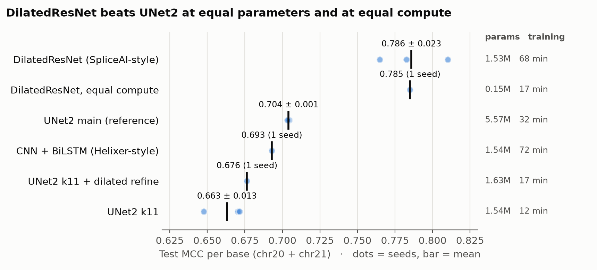
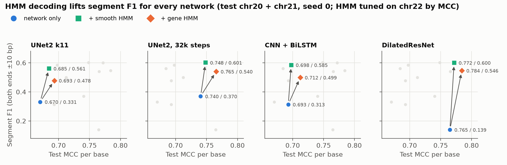
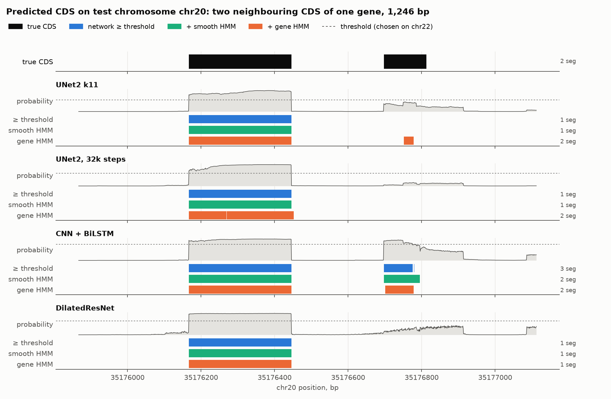

# Segmenting protein-coding sequence in human DNA with small networks: hypotheses, experiments, results

*Draft v2, 2026-11-25. Revisits the 2023 draft ([`draft_2023_cleaned.docx`](draft_2023_cleaned.docx)).
Items marked **[TBD]** are not yet run; *(1 seed)* marks indicative results; **[verify]** marks numbers from
other papers still to be checked against the original.*

## Abstract

**Goal.** Find out how well a small network trained from scratch can mark protein-coding sequence (CDS) base
by base in raw human DNA.

**Protocol.** Train on chromosomes 1–19, select on 22, test on whole chromosomes 20 and 21.

**Hypotheses.** The 2023 draft proposed a 1D U-Net, a two-stage "classify the window, then segment" design,
and modified Dice losses and metrics. We test those claims and three that arose along the way.

**Results.**
- The 2023 evaluation overstated quality, and per-window Dice can rank a model that never predicts CDS above
  every trained model.
- Small networks reach base-level MCC 0.66–0.79.
- A SpliceAI-style dilated CNN beats the U-Net at equal parameters and at equal compute.
- An HMM on top of any network roughly doubles segment-level F1.
- The two-stage design saves a quarter to a third of inference time but does not improve accuracy.

## 1. Goal and setup

**Goal.** For every base of a human chromosome, predict whether it lies in a CDS, using a network small enough
to train on a laptop. Then measure that properly and compare it with the alternatives.

**Data.** hg38 chromosomes 1–22; labels from RefSeq (GRCh38.p14, `BestRefSeq`). A base is positive if it lies
in any annotated CDS on either strand.

**Split.**
- Train: chromosomes 1–19.
- Validation (model, threshold and HMM selection): chromosome 22.
- Test: whole chromosomes 20 and 21, the SegmentNT split. 104 Mbp, 1.12 % CDS (1 : 89), 6,957 CDS segments.

**Metrics.**
- *Base-level MCC* (main). A predictor that always says "no" or always says "yes" scores 0; the metric is
  also used by SegmentNT and BEND.
- *AUPRC.*
- *Segment F1 ±10 bp.* A CDS segment counts only if both of its ends are within 10 bp of a true segment's ends.

**Training and inference** (same for all models).
- Training: 1-kb windows (half of them containing CDS), BCE loss, AdamW, batch 32, 16,000 steps. The best
  checkpoint is chosen by validation MCC.
- Inference: each chromosome is scanned in overlapping windows. Each window is averaged with its reverse
  complement, and its outer 250 bp are discarded.
- Hardware: one MacBook Pro (M2 Max). Training takes 12–73 min per model.

## 2. Hypotheses, experiments and results

### H1 (2023). The 2023 evaluation measures real quality — **not supported**

**Experiment.** We retrained the 2023 model under its original protocol:
- chromosome 1 only, with a random split of windows into train and test;
- CDS of 9–300 bp only;
- 1 : 1 positive/negative windows;
- Dice loss.

We then scored it on whole held-out chromosomes, and retrained the same architecture under the protocol above.

**Result.** The 2023 draft reported per-window Dice 0.53–0.65. On whole held-out chromosomes the same model
scores MCC 0.26 (two seeds 0.274 and 0.253; the third collapsed to a constant output). Under the honest
protocol it scores 0.425 ± 0.005. Two things drove the gap:
- the random split puts overlapping windows of the same genes in train and test;
- the length filter drops 32 % of coding bases.

### H2 (2023). Per-window Dice, or its modified variants, is a suitable metric and loss — **not supported**

**Experiment.**
- Score trained models and trivial predictors with per-window Dice, all Dice variants of the 2023 draft, MCC
  and AUPRC.
- Train with BCE, focal, Dice, Tversky and BCE + Dice losses.
- Score the same predictions on test sets of different composition: balanced, 1 : 5, 1 : 10 windows, and the
  natural ratio.

**Results.**
- **Dice as a metric.** An empty predictor scores per-window Dice **0.94** and beats every trained model. No
  variant from the draft changes that (`../docs/metric_study.png`). MCC gives it 0.
- **Dice as a loss.** Dice and Tversky losses collapse to a constant output. BCE with model selection by MCC
  works best.
- **Test-set composition.** It changes the ranking of models. The model that is best on balanced windows
  (MCC 0.827) is second-worst at the natural ratio (0.694). As empty windows are added, precision falls
  (0.996 → 0.729) while per-window Dice *rises* (0.82 → 0.95).
- **Imbalance.** The draft's "1 : 60 windows" was a base ratio on chromosome 1. The window ratio depends on
  window length: 1 : 47 at 150 bp, 1 : 1.2 at 50 kb.

### H3 (2023). A small 1D U-Net can segment CDS from raw DNA — **supported, with a better architecture found (see H5)**

**Experiment.** We improved the 2023 layout one change at a time, 3 seeds each.

**Result.**

| Model | Params | Test MCC | Segment F1 |
|---|---|---|---|
| 2023 model, honest protocol | 0.49 M | 0.425 ± 0.005 | 0.02 |
| + width, BatchNorm, batch 32, a convolution at 1 bp | 2.0 M | 0.594 ± 0.009 | 0.15 |
| **UNet2** (residual blocks, standard decoder) | 5.6 M | **0.704 ± 0.001** | 0.30 |
| UNet2, kernel 11 | 1.5 M | 0.663 ± 0.013 | 0.33 |
| UNet2, 32k steps *(1 seed)* | 5.6 M | 0.740 | 0.37 |

- **Residual blocks** are the largest gain (+0.11).
- **Reverse-complement averaging and edge cropping** add +0.03 MCC without retraining.
- **Width matters more than kernel size.**
- **Data helps only mildly:** 1 vs 19 training chromosomes give 0.680 vs 0.705 *(1 seed)*.
- **Training length is the biggest remaining lever** (0.705 → 0.740).

### H4 (2023). Classifying the window first and segmenting only positive windows improves results — **compute: yes; accuracy: no**

**Experiment.**
- A two-head UNet2: a window head on the bottleneck ("any CDS in this 1 kb?", +257 parameters) gates the
  decoder.
- Windows below a threshold that keeps 99 % of CDS windows on validation are not decoded.
- Compared with its one-head twin of the same size, trained separately.

**Result.**

| Model | Seeds | MCC gate on / off | Windows decoded | Inference time |
|---|---|---|---|---|
| One-head twin | 3 | — / 0.704 ± 0.001 | 100 % | — |
| Two-head, gate loss weight 1 | 3 | 0.627 / 0.627 | 64 % | −25 % |
| Two-head, gate loss weight 0.1 | 1 | 0.706 / 0.706 | 60 % | −29 % |
| Two-head, gate on detached features | 1 | 0.694 / 0.694 | 58 % | −33 % |

- **No accuracy cost at inference:** in every run, gate on equals gate off.
- **No fewer false positives:** the windows the gate drops were already predicted empty by the segmenter.
- **Training matters:** with equal loss weights, joint training hurts the shared encoder (−0.08). A gate
  weight of 0.1 removes the harm.

So the second stage is a free speed-up, not an accuracy gain.

### H5 (new). The U-Net is the right small architecture for this task — **not supported**

**Experiment.** Two standard architectures for base-level DNA annotation, trained under the same protocol at
the size of UNet2 kernel 11:
- a dilated residual CNN in the style of SpliceAI (12 residual blocks at 1-bp resolution, receptive field
  1.2 kb);
- a CNN + BiLSTM in the style of Helixer.

A narrow dilated CNN with UNet2's compute per window (~0.15 G multiply-adds) tests whether extra compute
explains the gap.

**Result.**

| Model | Params | Seeds | Test MCC | Segment F1 | Training |
|---|---|---|---|---|---|
| UNet2 kernel 11 | 1.54 M | 3 | 0.663 ± 0.013 | 0.33 | 12 min |
| UNet2 k11 + 4 dilated blocks before the head | 1.63 M | 1 | 0.676 | 0.23 | 17 min |
| CNN + BiLSTM | 1.54 M | 1 | 0.693 | 0.31 | 72 min |
| **DilatedResNet, equal compute** | **0.15 M** | 1 | **0.785** | 0.13 | 17 min |
| **DilatedResNet** | 1.53 M | 3 | **0.786 ± 0.023** | 0.16 | 68 min |

**The dilated CNN is about 0.12 MCC better per base** at equal parameters and at equal compute, the latter
with a tenth of the parameters. Its worst seed beats the best UNet2 kernel-11 seed.

**Its weakness is fragmentation:** about 50,000 predicted segments for 6,957 true ones.

**Adding dilated blocks to UNet2 does not close the gap.** The reason is open: possibly the absence of
downsampling, the depth of the residual stack, or the dilation schedule.

SegmentNT's own ablation shows the same direction **[verify]**: their SpliceAI-style CNN beat their U-Net
trained from scratch.

### H6 (new). Structured decoding fixes CDS boundaries — **supported**

**Experiment.** Viterbi decoding of each network's probabilities with two HMMs. Two emission parameters are
tuned on chromosome 22; nothing is retrained.
- *Smooth:* CDS / non-CDS with length priors.
- *Gene:* 14 states on both strands. It tracks codon phase through introns and allows transitions only at
  ATG, in-frame stop codons, GT/GC donors and AG acceptors.

**Result** (seed 0 of each network, test MCC / segment F1):

| Network | Raw | + smooth HMM | + gene HMM |
|---|---|---|---|
| UNet2 kernel 11 | 0.670 / 0.33 | 0.685 / 0.56 | 0.693 / 0.48 |
| UNet2, 32k steps | 0.740 / 0.37 | 0.748 / 0.60 | 0.765 / 0.54 |
| CNN + BiLSTM | 0.693 / 0.31 | 0.698 / 0.59 | 0.712 / 0.50 |
| DilatedResNet | 0.765 / 0.14 | 0.772 / 0.60 | 0.784 / 0.55 |

- **The smooth HMM raises segment F1 to 0.56–0.60 for every network**, and the segment count comes close to
  the truth.
- **It removes the dilated CNN's fragmentation.** After decoding, that network leads on both measures.
- **The gene HMM is best per base (+0.02 MCC) but cuts more segments than exist.** We suspect the union-of-isoforms
  label, which often does not form one valid gene structure (not yet tested).

*Example region chosen by rule (median of candidate exon pairs), not by eye. A 150-kb view is in
`../docs/tracks_region.png`.*

### H7 (2023 question). The model needs the full test window to work — **largely not**

**Experiment.** Fragments of 100 bp to 100 kb were predicted alone, without flanking sequence, as for draft
assemblies or contigs. This was measured on the 2023-layout model, whose MCC on whole chromosomes is 0.577.

**Result.**

| Fragment | MCC |
|---|---|
| 100 bp | 0.35 |
| 150 bp | 0.40 |
| 300 bp | 0.49 |
| 500 bp | 0.53 |
| 1 kb | 0.56 |
| ≥ 2 kb | 0.55 |

Accuracy plateaus 100–250 bp from a fragment edge, so the effective context is about ±250 bp.
**[TBD: repeat for UNet2 and the dilated CNN.]**

## 3. Summary

| # | Hypothesis | Origin | Verdict |
|---|---|---|---|
| H1 | The 2023 evaluation measures real quality | 2023 | ❌ Overstated: honest MCC 0.26 under the 2023 protocol |
| H2 | Dice (and its variants) is a suitable metric and loss | 2023 | ❌ An empty predictor scores 0.94; test composition flips model rankings |
| H3 | A small 1D U-Net can segment CDS from DNA | 2023 | ✅ MCC 0.70–0.74, but not the best small architecture |
| H4 | Classify-then-segment improves results | 2023 | ◐ 25–33 % less compute, no accuracy gain |
| H5 | The U-Net is the right small architecture | new | ❌ A dilated CNN is +0.12 MCC at equal parameters and compute |
| H6 | Structured decoding fixes boundaries | new | ✅ Segment F1 0.14–0.37 → 0.56–0.60 |
| H7 | The full window is needed | 2023 | ◐ ±250 bp of context suffices |
| H8 | A small model from scratch is competitive with a DNA foundation model on CDS | new | ⏳ **[TBD]**: SegmentNT on the same task and test set |

**Overall.**
- The largest effects in this work came from *how* the model was evaluated, not from the model. The 2023
  conclusions mostly reflected the protocol and the metric.
- Measured properly, small networks trained in under an hour on a laptop segment human CDS well per base.
  A dilated CNN is the better choice among them.
- Boundary quality depends mainly on structured decoding.
- The two-stage idea is worth keeping as a cheap speed-up. Its natural next test is on the dilated CNN, whose
  scan costs ~10× more per window, using pooled intermediate features because that network has no bottleneck.

## 4. Limitations and next steps

**Limitations.**
- **Test set used during model selection.** About 60 configurations were compared on the test chromosomes.
  Validation and test MCC agree closely (r = 0.994), but a final evaluation of frozen configurations, chosen
  on chromosome 22 only, is still needed.
- **No filter for homologous genes** between training and test chromosomes.
- **Metrics differ from those of gene finders.** We use base MCC and segment F1 against a union-of-isoforms
  label; gene finders report exon- and gene-level metrics.
- **Seeds and training budget.**
  - Several results rest on one seed (seed-to-seed spread 0.01–0.02 MCC).
  - All models are undertrained at 16k steps.
  - Baselines were not tuned.
- **Scope.** One species; 1-kb windows.

**Next steps [TBD].**
- Main comparison: SegmentNT (and AUGUSTUS or Tiberius) on chromosomes 20 and 21 with the same labels and
  metrics.
- Evaluation fixes:
  - homology filtering;
  - frozen final configurations with 3–5 seeds and confidence intervals;
  - exon-level metrics against a single-isoform label.
- Follow-up experiments:
  - ablation inside the dilated CNN;
  - the gate on the dilated CNN.

## References (to be completed; links in `../docs/LITERATURE_POSITIONING.ru.md`)

- SegmentNT: Dalla-Torre et al., Nature Methods 2025.
- Helixer: Holst et al., Nature Methods 2025.
- Tiberius: Gabriel et al., Bioinformatics 2024.
- SpliceAI: Jaganathan et al., Cell 2019.
- BEND: Marin et al., ICLR 2024.
- Metrics Reloaded: Maier-Hein et al., Nature Methods 2024.
- Tang & Koo, Genome Biology 2025.
